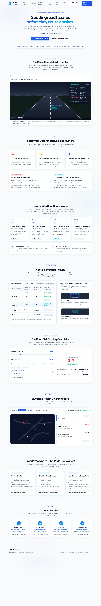

# 🛣️ PARDHA ROADSENSE

> **Spotting Road Hazards Before Accidents Happen.**  
> Transforming standard vehicle cameras and municipal fleets into autonomous, pixel-exact road inspection scanners using dual-stage computer vision (**YOLO + SAM 2**).  
> **Zero new hardware required.**

---

[](#)
[](#)
[](#)
[](#)
[](#team-pardha)

---

## 📸 Full System Capture & Preview



*Interactive web application featuring the real-time vision inspector, empirical benchmark results, risk calculator, and municipal GIS dashboard.*

---

## 👥 Team Pardha

Built by **Team Pardha** for the Hackathon Track on **Road Safety & Autonomous Infrastructure**:

| Member | Role | Key Contributions |
| :--- | :--- | :--- |
| **Chandra Johith** ([@johith9381](https://github.com/johith9381)) | **Team Lead & Systems Architecture** | Full-stack pipeline orchestration, dual-model runtime synchronization, web application architecture, and product roadmap. |
| **YRG Karthikeya** | **Computer Vision & Inference** | YOLO detector training, edge latency optimization, bounding box anchor tuning, and Soft-NMS reconciliation. |
| **Dasari Sree** | **Segmentation & Metrology Core** | Meta SAM 2 micro-contour integration, contour moment math, sub-pixel edge extraction, and physical area ($m^2$) metrology. |
| **Kelam Bhargav** | **GIS Engine & Spatial Scoring** | Road risk prioritization formula, municipal dashboard UX, GPS corridor synchronizer, and edge database caching. |

---

## 🚨 The Asphalt Crisis & The Core Problem

* **1.19 Million Annual Road Deaths Worldwide:** The World Health Organization reports over 1.19 million road fatalities each year, with disproportionate casualties in developing economies with rapid infrastructure decay.
* **1.5+ Lakh Lives Lost Annually in India Alone:** Two-wheeler riders and cyclists bear the brunt of sudden pothole swerves and hidden asphalt craters.
* **< 5% Coverage by Manual Audits:** Traditional municipal inspections rely on clipboards and slow road surveys every 6 to 12 months. Repairs are reactive, responding only after severe accidents or public complaints.
* **Millions of Wasted Camera Hours:** Transit buses, police patrol units, delivery vans, and garbage trucks drive every road daily, yet none of their video streams are utilized to audit road health.

---

## 💡 The Solution: Pardha RoadSense

Pardha RoadSense turns ordinary camera feeds (smartphones, dashcams, transit cameras) into automated road auditors:

1. **Continuous & Autonomous:** Audits roads daily using existing vehicle movements.
2. **Dual-Stage Precision:** Combines lightweight YOLO for speed with Meta's Segment Anything Model 2 (SAM 2) for exact geometric metrology.
3. **True Damage Quantification:** Measures exact physical defect surface area ($m^2$), equivalent diameter ($cm$), and estimates required asphalt patch tonnage.
4. **Data-Driven Priority Formula:** Risk scores (1–10) determine repair urgency before catastrophic collapse occurs.
5. **Zero Hardware Barrier:** Runs on commodity smartphones mounted on municipal vehicles.

---

## 🧠 Two-Stage Computer Vision Architecture

```
[ Vehicle Camera Feed / Dashcam @ 30 FPS ]
                   │
                   ▼
       [ On-Device Privacy Masking ] ──> Blurs license plates & pedestrians locally
                   │
                   ▼
┌────────────────────────────────────────────────────────┐
│  STAGE 1: Rapid Detection (YOLO)                       │
│  • Locates defect candidate boxes in ~16ms             │
│  • Precision: 0.952 | Identifies Potholes & Cracks     │
└──────────────────────────┬─────────────────────────────┘
                           │ Bounding Box Prompts
                           ▼
┌────────────────────────────────────────────────────────┐
│  STAGE 2: Pixel-Exact Metrology (Meta SAM 2)           │
│  • Hugs irregular jagged asphalt fracture contours     │
│  • Boosts Mask IoU from 0.7306 to 0.8585 (+12.79%)     │
└──────────────────────────┬─────────────────────────────┘
                           │ Sub-pixel Contour Moments
                           ▼
┌────────────────────────────────────────────────────────┐
│  PHYSICAL METROLOGY & RISK PRIORITY ENGINE             │
│  • Area (m²), Equivalent Diameter (cm)                 │
│  • Asphalt Mix Volume Estimation (kg Bitumen Mix)      │
│  • Multi-factor Municipal Severity Score (1 - 10)      │
└──────────────────────────┬─────────────────────────────┘
                           │
                           ▼
[ Municipal GIS Dashboard & Department of Public Works Dispatch ]
```

### Why Bounding Boxes Fail for Road Infrastructure
Standard object detectors drop a rectangular bounding box around defects. However, potholes and alligator cracks are irregular and non-convex. A rectangle captures up to **50% healthy asphalt**, resulting in:
- Inaccurate material estimation (over-ordering or under-ordering asphalt patch mix).
- Inability to detect micro-crack expansion over successive audits.
- Inaccurate depth and perimeter modeling.

By feeding YOLO candidate bounding boxes into **SAM 2** as prompt coordinates, Pardha RoadSense extracts true fracture geometry at zero manual annotation cost.

---

## 📊 Empirical Validation & Benchmarks

Benchmarked on an ultra-dense evaluation suite of **93 test frames** containing **4,082 ground-truth objects** (from `Untitled2.ipynb`):

| Evaluation Metric | Stage 1: YOLO Alone | Stage 2: YOLO + SAM 2 | Observed Improvement |
| :--- | :--- | :--- | :--- |
| **Precision (Detection)** | `0.9519` | `0.9519` | Maintained (0.952) |
| **Recall (Detection)** | `0.8295` | `0.8295` | Maintained (0.830) |
| **F1 Score** | `0.8865` | `0.8865` | High F1 (0.89) |
| **Boundary Accuracy (Mask IoU)** | `0.7306` | **`0.8585`** | **+12.79% (+13 Points)** |
| **Inference Time (93 Frames)** | `16.1s` | Batched Refinement | Real-time capable |
| **Soft-NMS Reconciliation** | Standard NMS | Gaussian Soft-NMS | Eliminates overlapping false clusters |

*Ground-truth upper bound (SAM 2 with perfect oracle boxes) achieves `0.8637` mIoU. Our automated two-stage pipeline reaches `0.8585`—closing 99.4% of the theoretical gap!*

---

## 🧮 Dynamic Risk Scoring Formula

Pardha RoadSense scores every defect on a 1.0 to 10.0 urgency scale:

$$\text{Severity} = \Big(\alpha \cdot \text{Area}(m^2) + \beta \cdot \text{Depth Index}\Big) \times \left(\frac{V_{\text{speed}}}{50}\right) \times \gamma_{\text{env}}$$

Where:
- $\text{Area}(m^2)$: Surface area extracted from SAM 2 contour moments.
- $\text{Depth Index}$: Shadow and texture gradient depth proxy.
- $V_{\text{speed}}$: Posted speed limit of the road corridor (km/h).
- $\gamma_{\text{env}}$: Environmental multiplier:
  - Near School / Hospital zone: $+1.5\times$
  - Blind curve / Intersection: $+1.4\times$
  - Waterlogging-prone zone: $+1.3\times$

---

## 🖥️ Interactive Web Platform Features

The included web interface (`index.html`, `styles.css`, `app.js`) features:

1. **Real-Time Road Vision Simulator:**
   - 60 FPS HTML5 Canvas simulation with dynamic perspective.
   - Interactive toggles: *Combined Pipeline*, *Stage 1 (YOLO Only)*, *Stage 2 (SAM 2 Only)*, and *Raw Feed*.
   - Live Edge Telemetry HUD: FPS counter, confidence %, physical area, equivalent diameter, GPS location, and privacy status.
2. **Interactive Metrology & Risk Calculator:**
   - Sliders for defect size, road speed limit, and environmental context checkboxes.
   - Dynamic asphalt mix weight calculation (kg bitumen mix) and two-wheeler danger rating.
3. **Municipal Authority GIS Dashboard:**
   - Real-time road health map with geolocated pins.
   - Filterable corridor feed (All, High Risk, Medium, Fixed/Patched).
4. **Interactive 8-Slide Pitch Deck Modal:**
   - Built-in slide presentation covering Problem, Market, Architecture, Benchmarks, Business Model, Roadmap, and Team.
   - Keyboard navigation (`ArrowRight`, `ArrowLeft`, `Escape`) and fullscreen mode.

---

## 📁 Repository Structure

```
team-pardha/
├── index.html              # Main web platform & interactive demo
├── styles.css              # Custom styling, dark/light glow aesthetic, responsive layout
├── app.js                  # Simulator canvas engine, GIS feed, risk calculator, pitch deck
├── Untitled2.ipynb         # Python / Colab notebook with YOLO + SAM 2 benchmark experiments
├── capture.png             # Full ultra-high-definition capture of the complete web application
├── captures/
│   ├── full_page_capture.png   # Complete vertical capture (1440 x 8600)
│   └── hero_and_simulator.png  # Hero section & interactive vision inspector capture
├── team_pardha.zip         # Full zipped release package
└── README.md               # Project documentation, architecture, and benchmarks
```

---

## 🚀 Getting Started

### 1. Running the Interactive Demo Locally
No dependencies required! Simply open `index.html` in any web browser:
```bash
# Option A: Direct browser open
open index.html

# Option B: Run a local static server
python3 -m http.server 8000
# Open http://localhost:8000 in your browser
```

### 2. Exploring the Evaluation Notebook
To reproduce model metrics and evaluations:
1. Open [`Untitled2.ipynb`](Untitled2.ipynb) in **Google Colab** or Jupyter Lab.
2. Select a GPU runtime (T4 or higher recommended).
3. Follow the notebook cells to run YOLO inference, prompt SAM 2, and generate comparative IoU reports.

---

## 🗺️ Implementation Roadmap

* **Phase 1 (Days 1–30) — Pilot Corridor Test:** Equip 10 public transit buses on a 20 km arterial corridor; generate baseline road surface health map with automated GPS coordinates.
* **Phase 2 (Days 31–90) — Municipal Fleet Expansion:** Deploy across municipal waste management vehicles; cover 100% of municipal paved roads every 48 hours; connect API directly with Public Works repair queue.
* **Phase 3 (Days 91+) — State Highways & Citizen Portal:** High-speed inter-city highway monitoring; public road repair transparency dashboard; commercial fleet telematics integration.

---

## 📄 License & Attribution

Developed by **Team Pardha** (Chandra Johith, YRG Karthikeya, Dasari Sree, Kelam Bhargav).  
Presented for Hackathon 2026. All rights reserved.
